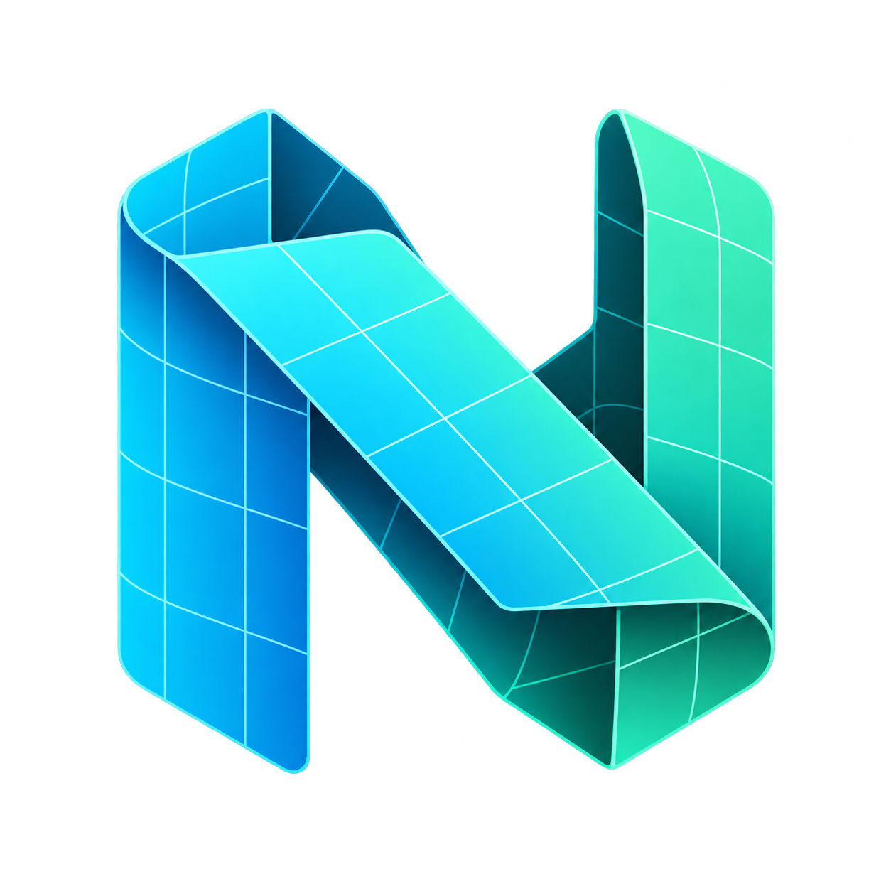

# Nexo UV



Addon de UV para Blender, escrito do zero a partir da análise funcional do pacote
Auto Unwrap 2.0.0 fornecido. Novo nome, logo e código; não inclui o OptCuts, Python
ou imagens do addon original. A investigação utilizou o
[REA](docs/rea/README.md), clonado em `/workspace/rea` para continuar o projeto.

**Versão 0.1.0.** Um único pacote Python atende Blender em macOS Intel,
macOS Apple Silicon, Windows e Linux. Requer Blender **4.2 ou superior**;
Minimum Stretch requer um Blender que disponibilize esse solver (4.3+).
A validação executada neste ambiente usa Linux x64 e Blender 4.3.2.
As outras plataformas têm uma matriz CI configurada, ainda não executada.

## Instalação

1. Gere os arquivos com `python tools/build.py` (Python 3.11+), ou use os ZIPs
   fornecidos em `dist/`.
2. No Blender, abra **Edit > Preferences > Get Extensions > menu > Install from Disk**.
3. Escolha `nexo_uv-0.1.0.zip` e ative **Nexo UV**. O formato alternativo
   `nexo_uv-0.1.0-legacy.zip` usa a instalação tradicional de addons.
4. Na viewport 3D, pressione **N** e abra a aba **Nexo UV**.

Não é necessário instalar Python externo, pacotes pip, bibliotecas, executar
binários auxiliares, configurar chaves ou ter acesso à internet no addon.
Use uma distribuição do Blender compatível com seu sistema e processador.

## Fluxo de trabalho

1. Selecione as malhas e execute **Analyze Mesh**. Corrija faces de área zero;
   bordas abertas e junções não manifold são relatadas separadamente.
2. Opcionalmente, execute **Analyze Parts**, escolha o critério e refine com
   seleção, merge ou criação de uma parte a partir das faces selecionadas.
   **Show / Hide Part Colors** alterna um preview de cores no modo Solid,
   preservando os materiais e restaurando a configuração anterior da viewport.
3. Escolha **Hard Surface**, **Organic** ou **Cloth / Garment**. **Plan Seams**
   marca costuras sem alterar UVs; inspecione-as antes do unwrap.
4. Execute **Unwrap**, ou **Smart UV · Hard Surface** para projeção por ângulo.
   Todas as malhas selecionadas compartilham um atlas no empacotamento final.
5. Refine com **Relax**, **Orient**, **Join Selected Islands** e relatório de qualidade.
   Para refazer somente algumas ilhas, selecione faces, use **Expand to UV Islands**,
   ative **Selected Faces Only** e execute **Unwrap** novamente.
6. Escolha margem/quantidade de tiles e execute **Repack / UDIM**. Faça stacking de
   repetições e simetria **depois** do último pack: empacotar novamente separa stacks.
7. Para bake, escolha tipo/resolução e execute **Bake Texture** com a malha ativa.
   A imagem é criada no Blender e deve ser salva pelo **Image Editor**.

## Ferramentas e melhorias

| Área | Implementação Nexo UV |
| --- | --- |
| Unwrap | Solvers nativos Angle Based, Conformal e Minimum Stretch quando disponível; Smart UV Project. |
| Costuras | Limites de partes, creases, graph cuts para superfícies curvas e cortes longitudinais de tecido. Costuras existentes podem ser preservadas. |
| Partes | Componentes conectados, ângulo, material ou costuras; atributo de faces persistente `nexo_part`; seleção, merge e split manual por faces. |
| Ilhas | Expansão da seleção por conectividade UV, redo de faces, união de patches abertos, relax e orientação por eixo principal. |
| UDIM | Distribuição determinística de ilhas inteiras em tiles a partir de 1001, com dez colunas. Bounding boxes não se sobrepõem. |
| Densidade | Normalização pela área no espaço global entre objetos, incluindo escala não aplicada; modo que mantém a escala UV ou recusa o pack se não couber. |
| Repetições | Matching conservador de componentes desconectados com a mesma topologia sob translação e escala uniforme positiva. |
| Simetria | Matching de geometria por X/Y/Z local, offset e tolerância; ilhas correspondentes sobrepostas sem mudar a malha. |
| Diagnóstico UV | Ilhas, triângulos invertidos/sem área e stretch calculado pelas escalas principais do mapeamento, normalizado pela área global. Overlay de stretch nativo no UV Editor aberto. |
| Bake | AO, Normal tangente, cor difusa sem iluminação e emissão, usando Cycles CPU. Materiais e configurações anteriores são restaurados. |
| Proteção | Backup do UV existente, restauração de seleção/modo, rollback de UVs/costuras/partes em falhas e preservação de pins. Malhas compartilhadas são recusadas com instrução para torná-las single user. |

O primeiro backup fica em `<UV Map>__backup`; nomes longos usam um sufixo com hash
para respeitar o limite do Blender. **Restore UV Backup** recupera os UVs e pins,
mantendo esse backup disponível. Para criar um backup mais recente, remova o mapa
de backup anterior manualmente. Se houver oito mapas UV, libere um antes de criar
outro mapa ou backup. A escolha do UV usado para renderização é preservada;
se quiser renderizar com o novo mapa, selecione-o explicitamente nos materiais ou
defina-o como UV de renderização. O bake usa o mapa escolhido no painel.

## Diferenças e limites

Os fluxos de trabalho foram recriados; **não há equivalência de algoritmo ou de
resultado com OptCuts**. O modo Cloth é geométrico e não reconhece automaticamente
camisas, calças e vestidos. A interface usa painéis nativos em vez do card com
desenho GPU do original. Brushes/lasso específicos de segmentação, preview do
plano de simetria e ocultação de costuras guiada por AO não fazem parte desta versão.

O pack usa caixas conservadoras, sem nesting ótimo, rotação automática ou
preservação de stacks prévios. Pins fixam a ilha inteira para pack/orient/stack;
ilhas já sobrepostas e fixadas não são reparadas. Operações de stacking e simetria
trabalham na malha completa, dentro de cada objeto; não comparam objetos distintos.
O relatório não substitui uma análise completa de interseções/overlap de UV.
Operações são síncronas e usam o Undo do Blender, sem progresso/cancelamento modal.
Backup de UV não é backup de geometria nem de costuras.

## Desenvolvimento e validação

```bash
python tools/build.py --check
blender --background --factory-startup --python-exit-code 1 --python tests/blender_smoke.py
blender --background --threads 2 --python-exit-code 1 --python tests/blender_bake_smoke.py
blender --background --command extension validate nexo_uv
python tools/build.py
```

O build verifica manifesto, licença, imports, código Python, conteúdo e CRC dos
ZIPs, exclui caches e rejeita engines/dependências nativas. Os arquivos têm ordem,
permissões e timestamp fixos; duas execuções produzem os mesmos hashes. O pacote
extension tem o manifesto na raiz; o legacy tem a pasta `nexo_uv/`.

[CI](.github/workflows/validate.yml) configura Blender 4.2.0/4.3.2 em Linux,
Windows, macOS Intel e Apple Silicon, com downloads oficiais verificados por
SHA-256. Essa configuração não comprova que os oito jobs passaram. O proxy deste
ambiente retornou HTTP 403 ao domínio oficial de downloads, impedindo testar uma
segunda versão do Blender aqui. Interface visível e Undo interativo também precisam
de validação manual nas plataformas de destino.

Consulte [o relatório de validação](docs/VALIDATION.md) e
[as evidências REA](docs/rea/README.md). Código e logo novos sob
[GPL-3.0-or-later](nexo_uv/LICENSE.txt). Não há afiliação com os autores do original.
